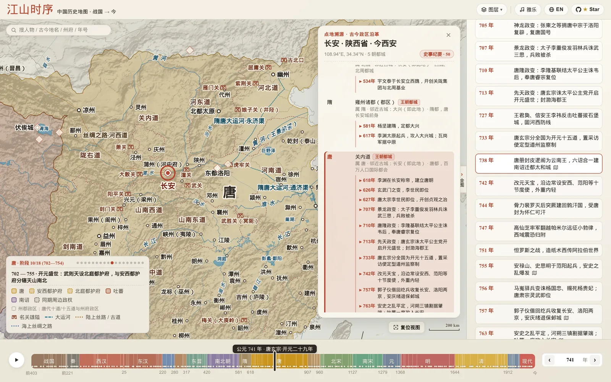
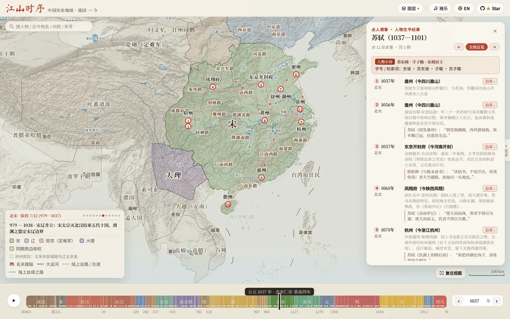

10 月 21 号一大早醒来，我随手刷了一下 [GitHub](https://github.com/DeanChensj/jiangshan-map)，发现前几天还只有几十个 star 的[「江山时序」](https://deanchen.me/jiangshan-map/)，一晚上多了一百多个。接下来几天，这个数字一路涨到了 1400。

到现在我还觉得有点不真实，所以还是写点东西，记录一下我为什么想做这样一个网站。

### 历史课本里的插图

我是个理科生，但从小就喜欢历史，也喜欢看地图。上学那会儿，历史、地理经常考全班最高分，一度很想选文科。可惜政治实在太差，一看到论述题就头疼，只好忍痛学了理科，后来顺理成章成了一名程序员。但喜欢人文地理的那颗心一直没变。

上学时我最爱翻的，就是初高中历史课本里的地图。看着大唐的疆域图，幻想贞观、开元的盛世；翻到宋朝，会为燕云十六州的丢失默默叹气；看到大明重整河山，再翻到清朝全盛时期的“秋海棠”，又总会兴奋半天。我常把不同朝代的地图摆在一起对比变迁，再对照今天的城市找位置，每次都有新发现。后来古文、诗词学得多了，读到诗文里的地名，我也习惯去地图上找找它们在今天的什么地方。

那时候我就想，要是有这么一张地图，能把整部中国历史的朝代更替都装进去，拖一下就能看变迁，可太酷了。

工作以后也看了不少历史书，印象最深的是渤海小吏的《两晋悲歌》和《南北归一》。每次读到五胡十六国，看到那一团浆糊似的政权更迭，脑子里总想拼出一张地图，却怎么也拼不清楚。

### 从半途而废的游戏，到第一版色块地图

这个想法在心里存了很多年，但从没想过自己动手。直到 Vibe Coding 慢慢流行起来，我才第一次觉得，好像真能把脑海里的画面做出来了。

今年 7 月我试着做过一个原型。当时想做的是个历史地理小游戏，可做到一半发现，比起游戏，我真正想看的其实还是那张地图本身；加上原型效果也一般，就先扔在一边了。

到了 10 月，模型能力又上了一个台阶，我把这个项目重新捡了起来，这次只做纯粹的地图。最开始只有一句很简单的 prompt：

> 帮我做一个能够拖动时间轴的中国历史地图。

AI 没花多少时间就交出了第一版：没有山川河流，只有几个粗糙的色块，朝代分得很粗，边界全是一条条直线和锯齿。但当我拖动底部的时间轴，看着那几个色块随着年份变大变小，还是被惊艳到了。

### 跟自己较劲，也跟历史较劲

从那天起，这个项目就有点停不下来了。两周半的时间，前前后后交了两百多次代码，大半是在深夜和周末写的。

时间这条横轴做出来以后，我又在想，能不能从每座城市出发，走一走地理这条纵轴？于是加了[「点地溯源」](https://deanchen.me/jiangshan-map/?year=741&place=%E9%95%BF%E5%AE%89)，点开任何一座城，就能看它两千多年里换过哪些名字、发生过哪些大事。有了横纵两条坐标轴，天与地都有了，那作为历史主角的人，是不是也能自然而然地走进这张地图？于是又有了[「点人溯事」](https://deanchen.me/jiangshan-map/?person=sushi)，把[张骞](https://deanchen.me/jiangshan-map/?person=zhangqian)、[玄奘](https://deanchen.me/jiangshan-map/?person=xuanzang)、[苏轼](https://deanchen.me/jiangshan-map/?person=sushi)这些人一生的行迹画在地图上。

<figure class="post-figure" data-lightbox-src="/assets/blog/jiangshan-tang-741-changan.webp" data-lightbox-title="盛唐开元二十九年（741 年）· 点开长安，看它两千多年的名字与大事">
  
  <figcaption>
    盛唐 741 年 · 点开长安，看它两千多年的沿革
    <svg viewBox="0 0 24 24" width="12" height="12" fill="none" stroke="currentColor" stroke-width="2" stroke-linecap="round" stroke-linejoin="round" aria-hidden="true"><polyline points="15 3 21 3 21 9"></polyline><polyline points="9 21 3 21 3 15"></polyline><line x1="21" y1="3" x2="14" y2="10"></line><line x1="3" y1="21" x2="10" y2="14"></line></svg>点击看大图
  </figcaption>
</figure>

再后来我灵机一动，给它配了个 [AI Skill](https://github.com/DeanChensj/jiangshan-map/tree/main/skills/jiangshan-atlas)，让任何人都能用自然语言调这张地图。随口问一句“[雪拥蓝关马不前](https://deanchen.me/jiangshan-map/?year=819&place=%E8%93%9D%E5%85%B3)”，它会定位到韩愈被贬潮州、立马蓝关的那一年，在图上标出蓝关；问一句“[问汝平生功业，黄州惠州儋州](https://deanchen.me/jiangshan-map/?year=1079,1080,1094,1097&place=%E6%B9%96%E5%B7%9E,%E9%BB%84%E5%B7%9E,%E6%83%A0%E5%B7%9E,%E5%84%8B%E5%B7%9E)”，它就把苏东坡一贬再贬的路线串起来画给你看。

<figure class="post-figure" data-lightbox-src="/assets/blog/jiangshan-sushi-journey.webp" data-lightbox-title="点人溯事 · 苏轼一生的宦海与贬谪行迹">
  
  <figcaption>
    点人溯事 · 苏轼一生的宦海与贬谪行迹
    <svg viewBox="0 0 24 24" width="12" height="12" fill="none" stroke="currentColor" stroke-width="2" stroke-linecap="round" stroke-linejoin="round" aria-hidden="true"><polyline points="15 3 21 3 21 9"></polyline><polyline points="9 21 3 21 3 15"></polyline><line x1="21" y1="3" x2="14" y2="10"></line><line x1="3" y1="21" x2="10" y2="14"></line></svg>点击看大图
  </figcaption>
</figure>

地图越做越细，较劲的地方也越来越多。我和 AI 一起在网上翻各种开源数据集，再对照《资治通鉴》和各朝正史一点点纠错。有一次我放大地图才发现，辽国的都城上京，居然被画在了辽国疆域外面，只好回头把辽北部的疆域和上京道一点点补齐。还有一次，横跨欧亚的蒙古帝国，在罗布泊那儿莫名其妙破了个窟窿，查了半天才补上。

等五胡十六国那一段修好，我对着自己的地图，把《两晋悲歌》又翻出来重读了一遍。以前怎么也分不清的前秦、后秦、西秦，这回终于理顺了。

### 从四处碰壁到被看见

地图有个样子之后，我先发在同事群和朋友圈里。不少喜欢历史的朋友提了建议，还有同事受启发做了衍生版本，有人做自己家乡的历史地图，有人拿地图来背唐诗。刚发上 GitHub 那会儿没几个人看，我还厚着脸皮发朋友圈找好友帮忙点 star。

为了让更多人看到，我加上了英文版，发到 LinkedIn 和 Reddit。LinkedIn 上毫无水花，Reddit 上反响倒不错，有位在海外的中国网友留言说，他用这张地图给孩子讲中国历史，孩子特别喜欢。

但回到中文平台上，我几乎试一个碰壁一个：自己发小红书、发知乎都被限流；抱着试试看的心态把项目投给几个知名的中文 GitHub 推荐社群，也没什么动静。

直到 X 上的「知识分享官」（[@knowledgegefxg](https://x.com/knowledgegefxg)）转发了我的网站，「江山时序」才第一次真正走进大众视野，几天之内收获了一千多个 star。好笑的是，我自己发小红书被限流，火了之后倒有不少人在小红书和公众号上搬运我的地图，他们反倒拿到了不少流量。

我刷着评论区，看到有人说“终于不用一边看历史一边搜这地方现在叫啥了”，有人操心“这么细的颗粒度，背后做数据清洗的得掉多少头发”，还有一条评论让我盯着看了很久：

> 拖动时间轴的那一刻，朝代不再是课本上的名词，而是脚下可以反复往返的山河。好工具让记忆有了坐标。

关注的人多了，项目也迎来了第一批外部贡献者：有人帮我优化了渲染性能，有人加了 GeoJSON 导出方便别人二次开发，有人把它做成了可以装到手机桌面上的应用，台湾的朋友帮我加上了繁体中文版，后台还收到了不少鼓励的私信。其中有一条 GitHub 回复只有一句话：

> 我儿子被这网站硬控好几天。

做这张地图的这些天，我把那些朝代翻来覆去温习了好多遍，常常一坐就到了半夜。我也是那个被硬控的小孩。

谁说理工男不懂浪漫呢？把两千多年的山河、城池和古人走过的路装进同一张图里，看到这么多人跟我共享着同一份热爱，何尝不是一种幸福。

感谢大家对「江山时序」的喜爱，感谢每一位点过 star、提过建议、贡献过代码的朋友。希望这张地图，能陪更多人走一遍故纸堆里的万里江山。
